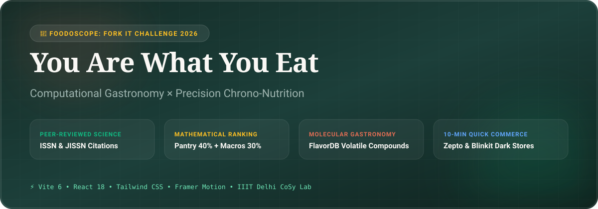
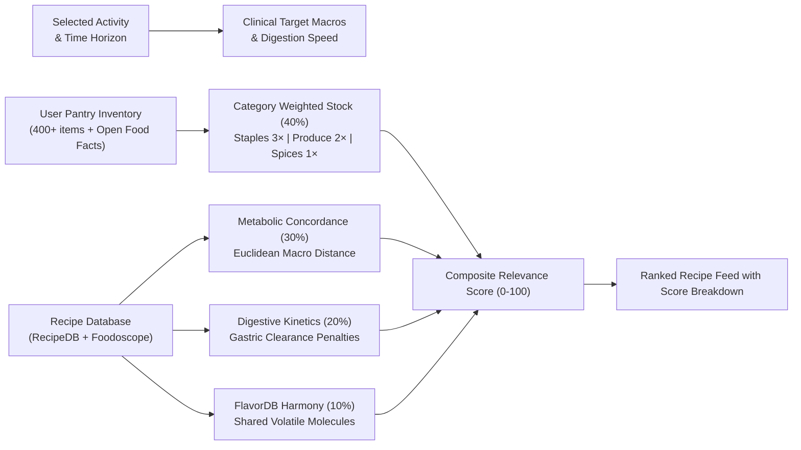

<div align="center">



# 🥑 You Are What You Eat (YAWYE)
### **Precision Chrono-Nutrition × Computational Gastronomy × 10-Minute Dark-Store Dispatch**

*A Next-Generation Culinary Intelligence Engine developed for the **Foodoscope: Fork It Challenge 2026** (Esya'26, IIIT Delhi / CoSy Lab)*

<p align="center">
  <a href="https://github.com/VisheshMis/you-are-what-you-eat/actions/workflows/ci.yml">
    
  </a>
  <a href="https://vercel.com">
    
  </a>
  <a href="https://react.dev">
    
  </a>
  <a href="https://vitejs.dev">
    
  </a>
  <a href="https://tailwindcss.com">
    
  </a>
  <a href="LICENSE">
    
  </a>
</p>

[**Explore Live Demo**](https://you-are-what-you-eat.vercel.app) • [**Report Bug**](https://github.com/VisheshMis/you-are-what-you-eat/issues) • [**Request Feature**](https://github.com/VisheshMis/you-are-what-you-eat/issues)

</div>

---

## 🌟 The Core Problem & Solution

| Traditional Nutrition Apps | **You Are What You Eat (YAWYE)** |
| :--- | :--- |
| Prescribe generic 2,000 kcal diets with static macro targets regardless of when you exercise. | **Chrono-Specific:** Calculates digestion velocity ($t_{1/2}$ clearance) and transporter kinetics (SGLT1 vs GLUT5) based on your exact time to activity (15m, 30m, 60m, 120m). |
| Suggest recipes containing dozens of ingredients you don't own, leading to abandoned meal prep. | **Inventory-Weighted:** Ranks meals using ingredients in your kitchen (40% algorithm weight), with a 1-click 10-minute dispatch bridge via Zepto & Blinkit for missing items. |
| Depend on subjective influencer advice or unverified blog posts. | **Peer-Reviewed Physiology:** Every meal recommendation links directly to clinical trials indexed in PubMed with PMIDs, DOIs, and verified mechanisms. |
| Ignore how ingredients taste together at a molecular level. | **Computational Gastronomy:** Leverages IIIT Delhi's **FlavorDB** to calculate volatile compound harmony scores and suggest molecularly compatible substitutions. |

---

## 🔬 Peer-Reviewed Chrono-Nutrition Database

Every activity protocol is directly derived from peer-reviewed exercise physiology and metabolic literature:

```
┌──────────────────────┬──────────────────────┬─────────────────┬────────────────────────────────────────────────────────┐
│ Activity & Window    │ Clinical Reference   │ Target Macros   │ Physiological Mechanism                                │
├──────────────────────┼──────────────────────┼─────────────────┼────────────────────────────────────────────────────────┤
│ Pre-Run (15m)        │ Burke et al. (2011)  │ 85% C / 10% P   │ Rapid gastric emptying (t½ < 20m), dual hexose uptake  │
│                      │ J Sports Sci         │ / 5% F          │ (SGLT1 & GLUT5) without GI distress or splanchnic lag. │
│                      │ PMID: 21660838       │                 │                                                        │
├──────────────────────┼──────────────────────┼─────────────────┼────────────────────────────────────────────────────────┤
│ Pre-Run (60m)        │ Jeukendrup (2014)    │ 70% C / 15% P   │ Moderate GI amylose for sustained hepatic glycogen;    │
│                      │ Sports Med           │ / 15% F         │ inorganic dietary nitrates for vasodilation.           │
│                      │ PMID: 24791914       │                 │                                                        │
├──────────────────────┼──────────────────────┼─────────────────┼────────────────────────────────────────────────────────┤
│ Pre-Gym (30m)        │ Schoenfeld (2017)    │ 60% C / 30% P   │ Circulating amino acid pool priming; cellular cAMP     │
│                      │ JISSN                │ / 10% F         │ stimulation without reactive hypoglycemia.             │
│                      │ PMID: 28919842       │                 │                                                        │
├──────────────────────┼──────────────────────┼─────────────────┼────────────────────────────────────────────────────────┤
│ Pre-Gym (90m)        │ Kerksick et al.(2017)│ 50% C / 35% P   │ Sustained hyperaminoacidemia (20-40g intact protein)    │
│                      │ JISSN                │ / 15% F         │ + slow-release amylose for intra-set ATP resynthesis.  │
│                      │ PMID: 28096757       │                 │                                                        │
├──────────────────────┼──────────────────────┼─────────────────┼────────────────────────────────────────────────────────┤
│ Post-Workout (Lift)  │ Morton, Phillips(18) │ 40% C / 45% P   │ Leucine threshold (≥3.0g) to trigger mTORC1            │
│                      │ Br J Sports Med      │ / 15% F         │ phosphorylation and muscle protein synthesis (MPS).    │
│                      │ PMID: 28698222       │                 │                                                        │
├──────────────────────┼──────────────────────┼─────────────────┼────────────────────────────────────────────────────────┤
│ Post-Run (Recovery)  │ Beelen et al. (2010) │ 65% C / 25% P   │ Non-insulin dependent GLUT4 translocation for rapid    │
│                      │ Int J Sport Nutr     │ / 10% F         │ supercompensated glycogen replenishment.               │
│                      │ PMID: 21116024       │                 │                                                        │
├──────────────────────┼──────────────────────┼─────────────────┼────────────────────────────────────────────────────────┤
│ Deep Work / Focus    │ Gómez-Pinilla (2008) │ 35% C / 30% P   │ Neuro-glycemic stability to prevent somnolence;        │
│                      │ Nat Rev Neurosci     │ / 35% F         │ omega-3 fatty acids for synaptic membrane fluidity.    │
│                      │ PMID: 18568016       │                 │                                                        │
└──────────────────────┴──────────────────────┴─────────────────┴────────────────────────────────────────────────────────┘
```

---

## 🧮 4-Factor Mathematical Weighting Engine

Recipes are dynamically scored and re-ranked using a weighted objective function:

$$\mathbf{\text{Relevance Score}} = 0.40 \cdot \mathcal{S}_{\text{inventory}} + 0.30 \cdot \mathcal{S}_{\text{metabolic}} + 0.20 \cdot \mathcal{S}_{\text{timing}} + 0.10 \cdot \mathcal{S}_{\text{flavor}}$$



1. **Inventory Availability ($\mathcal{S}_{\text{inventory}}$ — 40% weight):**
   - Core protein & carbohydrate staples (chicken, paneer, tofu, oats, eggs) weighted at **$3\times$**.
   - Fresh produce and dairy weighted at **$2\times$**.
   - Pantry condiments, oils, and seasonings weighted at **$1\times$**.
2. **Metabolic Concordance ($\mathcal{S}_{\text{metabolic}}$ — 30% weight):**
   - Normalized Euclidean distance between recipe macro split and clinical targets.
3. **Digestive Kinetics ($\mathcal{S}_{\text{timing}}$ — 20% weight):**
   - Strict penalties on fat ($>12\text{g}$) and fiber ($>6\text{g}$) within 30 minutes of running or HIIT to prevent splanchnic hypoperfusion and gastrointestinal distress.
   - Rewards high-leucine protein post-lifting.
4. **FlavorDB Volatiles ($\mathcal{S}_{\text{flavor}}$ — 10% weight):**
   - Overlap of volatile chemical compounds (pyrazines, terpenes, aldehydes) from IIIT Delhi's CoSy Lab research.

---

## 🛠️ Tech Stack & Architecture

- **Frontend:** React 18.3, Vite 6.0, Tailwind CSS 3.4
- **Motion & UI Dynamics:** Framer Motion 14.9, Lucide Icons, Canvas Confetti
- **Scientific Databases:**
  - **Open Food Facts API:** Real-time search across 3,000,000+ consumer grocery items with automated nutritional categorizer.
  - **Foodoscope & RecipeDB:** Official REST API endpoints from IIIT Delhi CoSy Lab (`https://api.foodoscope.com`).
  - **PubMed Exercise Physiology Standard:** Indexed PMIDs and clinical study models.

```
src/
├── components/
│   ├── ActivitySelector.jsx         # Physical state selector & verified PubMed research box
│   ├── RecipeCard.jsx               # 3D interactive tilt card with relevance score breakdown
│   ├── PantryManager.jsx            # 400+ item catalog + Open Food Facts instant search
│   ├── BentoScienceHub.jsx          # Interactive glycemic & digestive kinetics dashboard
│   ├── WhyRecommendModal.jsx        # Scientific deep-dive with PubMed citation modal
│   ├── QuickCommerceModal.jsx       # 10-min Zepto/Blinkit dark store courier dispatch
│   ├── ApiInspector.jsx             # Live Foodoscope API schema & payload inspector
│   └── FoodoscopeApiKeyModal.jsx    # Live Bearer token authentication manager
├── data/
│   ├── sportsScienceResearch.js     # Peer-reviewed exercise physiology citations
│   ├── recipeEngine.js              # 4-factor mathematical relevance ranking engine
│   ├── pantryDatabase.js            # 400+ curated items with emojis, categories, and tags
│   └── mockData.js                  # Baseline recipes, activities, and volatile pairings
└── services/
    ├── foodoscopeApi.js             # Official Foodoscope / RecipeDB client
    └── openFoodFacts.js             # Open Food Facts API client with auto-classification
```

---

## 🚀 Quick Start (Local Setup)

```bash
# Clone the repository
git clone https://github.com/VisheshMis/you-are-what-you-eat.git
cd you-are-what-you-eat

# Install dependencies
npm install

# Run Vite development server
npm run dev
```

Open **`http://localhost:3000`** in your browser.

---

## 🌐 Deploying to Vercel

### Option 1: 1-Click via GitHub
1. Fork or push this repository to your GitHub account.
2. Go to **[vercel.com/new](https://vercel.com/new)** and import `you-are-what-you-eat`.
3. Vercel automatically detects Vite:
   - **Framework:** `Vite`
   - **Build Command:** `npm run build`
   - **Output Directory:** `dist`
4. Click **Deploy**. Your application will be live instantly!

### Option 2: Deploying via Vercel CLI
```bash
npx vercel
```

---

## 🗺️ Product Roadmap

- [ ] **Mobile Computer Vision Fridge Scanner:** Take a photo of your open fridge to populate your pantry automatically.
- [ ] **Wearable Synchronization:** Real-time webhook integration with Apple Health, Garmin, and Whoop to detect completed workouts and trigger recovery countdowns.
- [ ] **Full-Screen Interactive Cook Mode:** Voice-guided hands-free instructions and kitchen stage timers.
- [ ] **Continuous Glucose Simulation:** Plot simulated CGM curves for each meal compared to fast-food baselines.

---

## 📄 License & Citations

- Built for **Foodoscope: Fork It Challenge 2026** (Esya'26, IIIT Delhi).
- Gastronomic data inspired by **CoSy Lab, IIIT Delhi**.
- Licensed under the [MIT License](LICENSE).
