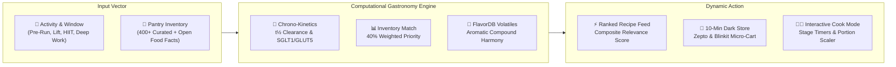

<div align="center">


# 🥑 You Are What You Eat (YAWYE)
### **Precision Chrono-Nutrition × Computational Gastronomy × 10-Minute Dark-Store Dispatch**

*Developed for the **Foodoscope: Fork It Challenge 2026** (Esya'26, IIIT Delhi / CoSy Lab)*

<p align="center">
  <a href="https://github.com/VisheshMis/you-are-what-you-eat/actions/workflows/ci.yml">
    
  </a>
  <a href="https://react.dev">
    
  </a>
  <a href="https://vitejs.dev">
    
  </a>
  <a href="https://tailwindcss.com">
    
  </a>
  <a href="LICENSE">
    
  </a>
</p>

</div>

---

## ⚡ System Architecture



---

## 🧬 Key Innovations

<table>
  <tr>
    <td width="50%">
      <h3>⏱️ Precision Chrono-Nutrition</h3>
      <p>Replaces static 2,000 kcal recommendations with physiological gastric transit timing ($t_{1/2} < 20$m) and dual-transporter kinetics (SGLT1 &amp; GLUT5).</p>
      <b>Indexed Citations:</b> <i>Burke et al. (2011)</i>, <i>Jeukendrup (2014)</i>, <i>Morton &amp; Phillips (2018)</i>.
    </td>
    <td width="50%">
      <h3>🥫 Inventory-Weighted Ranking</h3>
      <p>Prioritizes recipes using ingredients already in your pantry ($40\%$ weight). Core staples are weighted $3\times$, fresh produce $2\times$, and seasonings $1\times$.</p>
      <b>Impact:</b> Zero abandoned meal prep.
    </td>
  </tr>
  <tr>
    <td width="50%">
      <h3>🧪 FlavorDB Molecular Gastronomy</h3>
      <p>Calculates shared aromatic compound overlap (vanillin, eugenol, cinnamaldehyde) using CoSy Lab models, unlocking scientific substitutions for missing items.</p>
      <b>Source:</b> IIIT Delhi FlavorDB Volatile Profiles.
    </td>
    <td width="50%">
      <h3>👨‍🍳 Hands-Free Cook Mode &amp; Portion Scaler</h3>
      <p>Step-by-step countertop guidance with automated stage timers, audio completion chimes, dynamic portion scaling ($0.75\times$ to $2\times$), and printable kitchen sheets.</p>
      <b>Features:</b> Active countdowns &amp; mise-en-place tracking.
    </td>
  </tr>
</table>

---

## 🧮 4-Factor Mathematical Objective Function

$$\mathbf{\text{Relevance Score}} = 0.40 \cdot \mathcal{S}_{\text{inventory}} + 0.30 \cdot \mathcal{S}_{\text{metabolic}} + 0.20 \cdot \mathcal{S}_{\text{timing}} + 0.10 \cdot \mathcal{S}_{\text{flavor}}$$

```
┌──────────────────────┬─────────┬─────────────────────────────────────────────────────────────────┐
│ Component            │ Weight  │ Scoring Formulation                                             │
├──────────────────────┼─────────┼─────────────────────────────────────────────────────────────────┤
│ 🥫 Inventory Stock   │ 40%     │ Category-weighted availability (Staples 3×, Produce 2×, Spices 1×)│
│ 🎯 Metabolic Target  │ 30%     │ 100 − (Normalized Euclidean distance to clinical macro split)    │
│ ⏱️ Digestive Timing  │ 20%     │ Gastric clearance penalty (<30m: Fat & Fiber cap; Post: Leucine) │
│ 🧪 FlavorDB Volatiles│ 10%     │ Molecular shared volatile compounds & aromatic pairing harmony  │
└──────────────────────┴─────────┴─────────────────────────────────────────────────────────────────┘
```

---

## 🔬 Peer-Reviewed Clinical Evidence

| Activity & Horizon | Reference Journal | Target Macros | Mechanism & Physiological Target |
| :--- | :--- | :--- | :--- |
| **Pre-Run (15m)** | *J Sports Sci* ([PMID: 21660838](https://pubmed.ncbi.nlm.nih.gov/21660838/)) | 85% C / 10% P / 5% F | Rapid gastric emptying ($t_{1/2} < 20\text{m}$); dual-channel SGLT1/GLUT5 absorption. |
| **Pre-Run (60m)** | *Sports Med* ([PMID: 24791914](https://pubmed.ncbi.nlm.nih.gov/24791914/)) | 70% C / 15% P / 15% F | Low-GI amylose sustained glycogen; dietary nitrate vasodilation. |
| **Pre-Gym (30m)** | *JISSN* ([PMID: 28919842](https://pubmed.ncbi.nlm.nih.gov/28919842/)) | 60% C / 30% P / 10% F | Free amino acid pool priming; cellular cAMP stimulation. |
| **Pre-Gym (90m)** | *JISSN* ([PMID: 28096757](https://pubmed.ncbi.nlm.nih.gov/28096757/)) | 50% C / 35% P / 15% F | 20–40g intact protein + slow-release amylose for intra-set ATP regeneration. |
| **Post-Workout (Lift)** | *Br J Sports Med* ([PMID: 28698222](https://pubmed.ncbi.nlm.nih.gov/28698222/)) | 40% C / 45% P / 15% F | $\ge 3.0\text{g}$ Leucine trigger stimulating mTORC1 muscle protein synthesis. |
| **Post-Run (Recovery)** | *Int J Sport Nutr* ([PMID: 21116024](https://pubmed.ncbi.nlm.nih.gov/21116024/)) | 65% C / 25% P / 10% F | Non-insulin dependent GLUT4 translocation for glycogen supercompensation. |
| **Deep Work Focus** | *Nat Rev Neurosci* ([PMID: 18568016](https://pubmed.ncbi.nlm.nih.gov/18568016/)) | 35% C / 30% P / 35% F | Neuro-glycemic stabilization; omega-3 fatty acids for synaptic membrane fluidity. |

---

## 🛠️ Tech Stack & Directory Overview

```
src/
├── components/
│   ├── ActivitySelector.jsx       # Physical state selector & verified PubMed research box
│   ├── RecipeCard.jsx             # 3D interactive tilt card with relevance score breakdown
│   ├── CookModeModal.jsx          # Countertop step-by-step guidance, timers & portion scaler
│   ├── BentoScienceHub.jsx        # Interactive glycemic & digestive kinetics dashboard
│   ├── PantryManager.jsx          # 400+ item catalog + Open Food Facts instant search
│   ├── QuickCommerceModal.jsx     # 10-min Zepto/Blinkit dark store courier dispatch
│   └── ApiInspector.jsx           # Live Foodoscope API schema & payload inspector
├── data/
│   ├── sportsScienceResearch.js   # Peer-reviewed exercise physiology citations
│   ├── recipeEngine.js            # 4-factor mathematical relevance ranking engine
│   └── pantryDatabase.js          # 400+ curated items with emojis, categories, and tags
└── services/
    ├── foodoscopeApi.js           # Official Foodoscope / RecipeDB client
    └── openFoodFacts.js           # Open Food Facts API client with auto-classification
```

---

## 💻 Quick Start

```bash
# 1. Clone repository
git clone https://github.com/VisheshMis/you-are-what-you-eat.git
cd you-are-what-you-eat

# 2. Install dependencies & run
npm install
npm run dev
```

Platform opens at **`http://localhost:3000`**.

---

## 📄 License & Acknowledgments

- Built for **Foodoscope: Fork It Challenge 2026** (Esya'26, IIIT Delhi).
- Gastronomic data inspired by **CoSy Lab, IIIT Delhi** (RecipeDB & FlavorDB).
- Licensed under the [MIT License](LICENSE).
